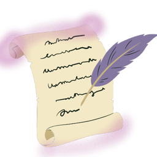

  

<h1 align="center">Saintmaxxing</h1>

  A short narrative RPG built in <strong>Godot 4.7</strong>, where a wise unicorn roams a chaotic medieval town and has a little word with its colorful residents.

## About

**Saintmaxxing** is a choice-driven dialogue RPG with a cast of morally ambiguous townsfolk. As the unicorn, you dust each of them with your shimmering wisdom… whether they want it or not.

The game opens with the unicorn's monologue, setting the chaotic scene, before letting the player roam through the character roster and dive into branching conversations that lead to good or bad endings.

## Built With

- [Godot Engine 4.7](https://godotengine.org/) 
- GDScript 
